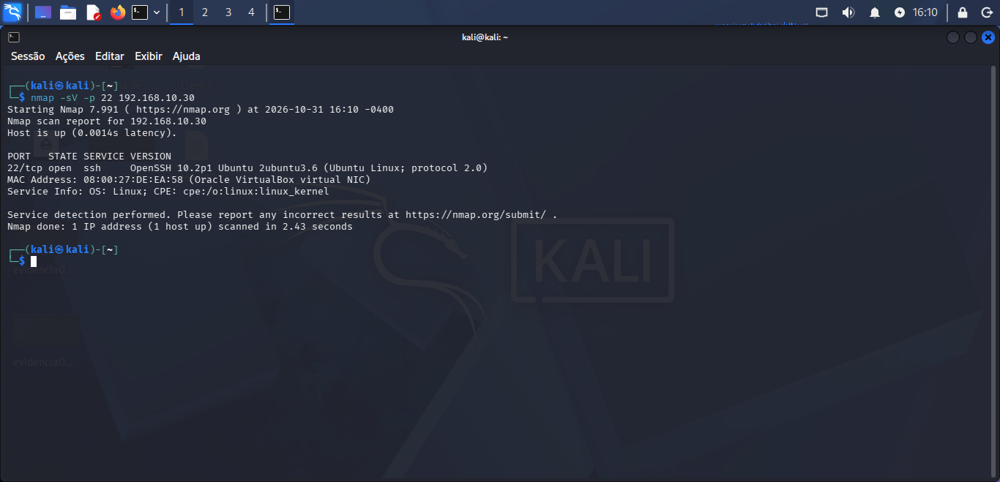

# Projeto 1 — Analista SOC

## 1. Objetivo do projeto
Desenvolver habilidades práticas de um Analista SOC (Security Operations Center), trabalhando com monitoramento de redes, identificação de serviços, análise de eventos e investigação de possíveis ameaças.

## 2. Ambiente de laboratório

Laboratório desenvolvido no VirtualBox, utilizando três máquinas virtuais:

- Kali Linux — máquina de análise
- Windows — máquina de testes
- Ubuntu — servidor de laboratório

As máquinas estão conectadas por uma rede interna isolada, configurada para práticas controladas de segurança da informação.

## 3. Etapa 1 — Reconhecimento da rede

Realização de descoberta de dispositivos ativos na rede interna, identificando os endereços IP disponíveis e os equipamentos conectados ao laboratório.

## 4. Identificação de serviços

Utilização do Nmap para identificar serviços e versões em execução nas máquinas do laboratório.

Comando utilizado:

```bash
nmap -sV -p 22 <IP_DO_UBUNTU>
```

Foi identificado o serviço OpenSSH na máquina Ubuntu, na porta 22/tcp, com a versão 10.2p1.

### Evidência — Identificação do serviço SSH


